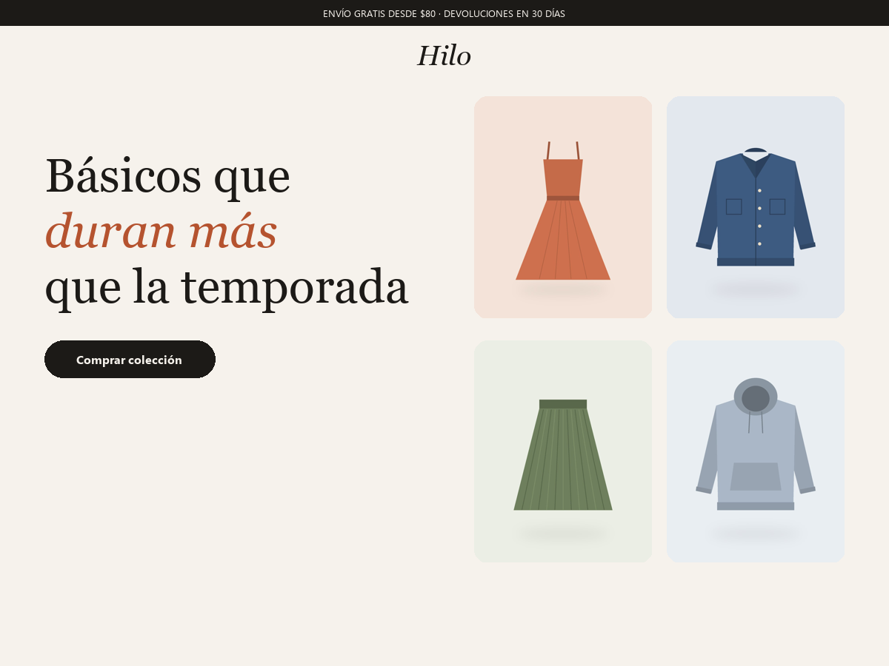

# Hilo — Tema WordPress + WooCommerce para tienda de ropa



**Hilo** es un tema de bloques creado desde cero para tiendas de moda con WooCommerce. Está centrado en la **visualización de producto**: cómo se ven las prendas en el catálogo, cómo se combinan en un lookbook y cómo se descubren por categoría.

### ▶ [Ver demo en vivo (WordPress Playground)](https://playground.wordpress.net/?blueprint-url=https://raw.githubusercontent.com/LuisMRojas/wp-hilo-fashion-store/main/blueprint.json)

> La demo instala WordPress + WooCommerce en tu navegador, activa el tema e importa un catálogo de 8 prendas con categorías, ofertas e imágenes. Tarda unos 20–40 segundos.

## Visualización de productos

| Función | Cómo funciona |
| --- | --- |
| **Cambio de imagen al pasar el cursor** | La tarjeta muestra la primera imagen de la galería (otro color) al hacer hover. Hook `woocommerce_before_shop_loop_item_title`. |
| **Muestras de color** | Círculos de color bajo cada producto, leídos del meta `_hilo_swatches`. |
| **Etiquetas inteligentes** | “-20 %” calculado automáticamente en ofertas y “Nuevo” para productos de menos de 30 días. |
| **Botón flotante “Añadir al carrito”** | Aparece sobre la imagen al pasar el cursor; en pantallas táctiles queda siempre visible. |
| **Lookbook interactivo** | Imagen con puntos (*hotspots*) que despliegan una mini‑ficha con foto, precio y enlace a la prenda. Accesible con teclado. |
| **Rejilla 4:5 responsive** | CSS Grid de 4 columnas (2 en móvil) con proporción editorial de moda. |

## Otras características

- Cabecera con barra de anuncios, navegación por categorías, buscador de productos, cuenta y **mini‑carrito** de WooCommerce.
- Patrones: Portada de colección, Categorías, Novedades, Lookbook, Beneficios y Newsletter.
- Plantillas propias para tienda y categorías (`archive-product`, `taxonomy-product_cat`); ficha de producto, carrito y checkout usan las plantillas de bloques de WooCommerce y heredan el estilo de `theme.json`.
- Galería de producto con zoom, lightbox y slider.
- **Importador de demo** (`demo/import.php`) que crea categorías, productos, atributos (Color, Talla), ofertas e imágenes.
- Ilustraciones de producto **originales**, generadas para el tema (sin fotos de stock).

## Instalación

1. Instala y activa **WooCommerce**.
2. Descarga este repositorio como ZIP y súbelo en **Apariencia → Temas → Añadir nuevo → Subir tema**. Activa **Hilo**.
3. (Opcional) Importa el catálogo de ejemplo con WP‑CLI:
   ```bash
   wp eval-file wp-content/themes/hilo/demo/import.php
   ```

Requisitos: WordPress 6.5+, WooCommerce 8+, PHP 7.4+.

## Estructura

```
hilo/
├── theme.json               # Sistema de diseño
├── functions.php            # Soporte WooCommerce, hover, muestras, etiquetas
├── assets/css/hilo.css      # Rejilla de productos, lookbook, newsletter
├── assets/js/hilo.js        # Cabecera, hotspots táctiles, newsletter demo
├── assets/products/         # Ilustraciones de producto (2 colores por prenda)
├── parts/  templates/  patterns/
├── demo/import.php          # Catálogo de ejemplo
└── blueprint.json           # Demo en WordPress Playground
```

## Tecnologías

WordPress Block Themes · WooCommerce (hooks y bloques) · theme.json · CSS Grid · JavaScript vanilla · Python/Pillow (generación de ilustraciones).

## Licencia

GPL-2.0-or-later. Tipografías Bodoni Moda y Manrope (Google Fonts, OFL).
